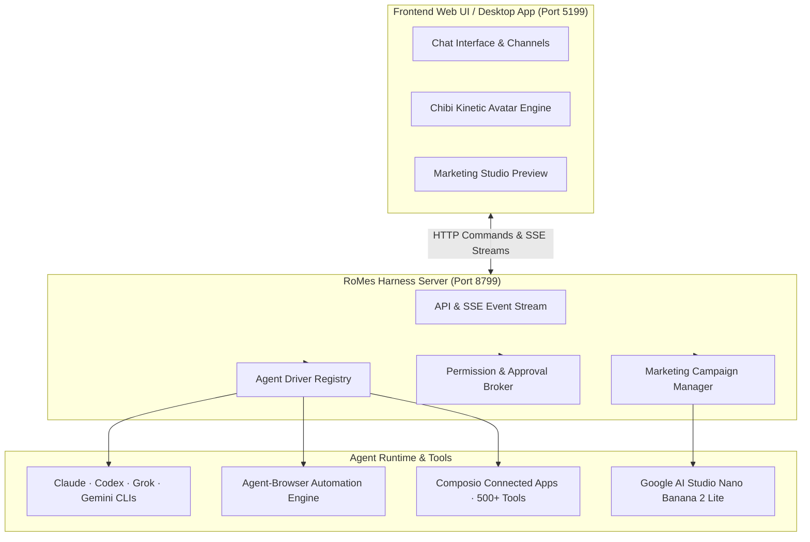

<div align="center">

# RoMes

**Local-first Autonomous AI Agent Team & Automated Marketing Studio**

A privacy-focused desktop and web application where every contact is a real, autonomous AI agent with hands, tools, and distinct personalities.

[](https://github.com/QnShiChi/RoMes)


<br>

Every bot in your sidebar is an autonomous agent running locally on your own machine — equipped with its own persona, model fleet, cloud/local computer, browser automation, and 500+ connected apps.

<br>

</div>

---

## 🌟 What is RoMes?

**RoMes** is an open-source, local-first chat workspace engineered to run a coordinated team of autonomous AI agents. Unlike traditional single-prompt chatbot interfaces, RoMes organizes AI into an intuitive messaging layout:

- **Bring Your Own Agents**: Bots run directly on local CLIs and APIs (`claude`, `codex`, `grok`, `gemini`) using your existing subscriptions — no proxy, no cloud middleman.
- **Local-First Privacy**: Agent transcripts, memory, encryption keys, and configurations reside exclusively on your local device in `~/.openmausbot`.
- **Hands & Automation**: Every agent can operate isolated cloud Linux desktops, local VMs, host-level computer vision, or automated web browsers.
- **500+ Connected Apps**: Native OAuth integrations powered by Composio (Gmail, Slack, GitHub, Notion, Linear, Google Calendar, and more).

---

## 🚀 Key Innovations & Features

### 🎨 1. Handcrafted Chibi Mascots & Dynamic Kinematics
RoMes features a suite of 10 vector Chibi mascots, each designed with multi-layer SVG art (underlay, body contour, facial expressions, and foreground accessories) and dedicated dynamic physics:

| Mascot | Archetype & Accessories | Custom Motion Personality |
|---|---|---|
| **Robo-Planner** (`cursor`) | Cyber visor, headset mic, clipboard | **Servo Stepper**: Mechanical micro-pauses at peak, stepping servo snap |
| **Octo-Multi** (`blob`) | 8 tentacles, phone, calendar, laptop, stylus | **Oceanic Wave Float**: Dual-axis sinewave floating with jelly elasticity |
| **Tech-Bear** (`circle`) | VR goggles, mechanical laptop, hoodie | **VR Beat Groove**: Offbeat rhythmic keyboard bobbing & immersive head sway |
| **Smart-Cat** (`squircle`) | Headset, megaphone, radio tail | **Springy Pop Hop**: Deep squash preparation followed by rapid spring jumps |
| **Data-Owl** (`capsule`) | Mortarboard cap, analytics board | **Curious Head-Tilt**: Perched stability with deliberate inquisitive head turns |
| **Creative-Fox** (`drop`) | Beret, stylus pen, graphics tablet | **Playful Sway & Draw**: Graceful hip and tail swaying with pen stroke arcs |
| **Post-Bunny** (`shield`) | Long floppy ears, mail backpack, delivery envelope | **High Gravity Bunny Hop**: High parabolic hops with hang-time floating |
| **Shield-Dog** (`hexagon`) | Knight visor, chest badge, energy shield | **Guard Stomp & Shield Bump**: Firm stomping beats with defensive shield bumps |
| **Heart-Otter** (`diamond`) | Floating chest heart, floating chat bubble | **Backstroke Glide**: Gentle water drifting with rhythmic heart-hug breathing |
| **Star-Lion** (`star`) | Solar mane, victory trophy, camera rig | **Champion Victory Bounce**: Celebratory star bounce with radiant angles |

---

### 📸 2. Automated Marketing Studio (Google AI Studio Core)
RoMes includes a built-in Marketing Studio engine capable of generating commercial-grade visual campaigns:
- **Nano Banana 2 Lite Engine**: Connects directly to Google AI Studio's `gemini-3.1-flash-lite-image` engine to produce crisp **1408×768** studio photographs.
- **Multi-angle Commercial Photography**:
  1. *Hero Studio Shot*: Pure product aesthetics, studio lighting, materials, and branding typography.
  2. *Lifestyle Shot*: In-context real-world usage scenarios with authentic interactions.
  3. *Close-up Feature Shot*: Macro details highlighting key capabilities and premium craftsmanship.
- **Background Headless Pipeline**: Automated browser control generates, inspects, and downloads full-resolution image assets without requiring manual web navigation.

---

### 📢 3. Hybrid Publishing Workflow (Preview & Confirm)
A safe, reliable two-phase workflow designed for social media and content marketing:
1. **Phase 1: Content Synthesis & Chat Preview**:
   - Researches and authors high-converting copy using AIDA or PAS frameworks.
   - Generates matching commercial photographs and embeds them directly in the chat thread.
   - Displays a comprehensive draft preview and halts execution, awaiting explicit user approval.
2. **Phase 2: Hybrid Multi-Channel Dispatch**:
   - **Facebook Personal & Fanpage**: Automated posting via `agent_browser`, composing formatted text and uploading image albums natively.
   - **Email Campaigns**: Dispatches branded announcements via Composio Gmail integration.
   - Saves publishing receipts and live URLs to thread metadata.

---

### 🧠 4. Model Diversity & Agent Collaboration
- **Per-Bot Engine Configuration**: Assign Claude 3.7 Sonnet to your software architect, Gemini 2.5 Flash to your researcher, and Grok to your social analyst.
- **Channels & Team Rooms**: Group bots into dedicated project channels where agents collaborate, take turns, and hand off tasks.
- **Human-in-the-Loop Approvals**: Risky commands, terminal executions, and file modifications prompt interactive Allow/Deny approval cards.

---

### 🎧 5. Voice Synthesis & Real-Time Duplex Calls
- **Read Aloud & Voice Calls**: Talk with your bots in real time with low-latency spoken responses.
- **Voice Providers**: Integrated support for ElevenLabs, Fish Audio, Grok (xAI) TTS, Apple Native Speech, and local Chatterbox servers.

---

## 🏗️ Architecture

RoMes runs as two lightweight cooperating processes:



---

## ⚡ Quick Start

### Prerequisites
- **Node.js**: Version 24+
- **Package Manager**: `pnpm` (version 10+)
- **Operating System**: Linux (Ubuntu/Debian), macOS (Apple Silicon / Intel), or Windows 10/11
- **At least one AI CLI or API Key**: Claude (`claude`), Codex (`codex`), or Gemini / Grok

### 1. Clone & Install

```bash
git clone https://github.com/QnShiChi/RoMes.git
cd RoMes
pnpm install
```

### 2. Run the Development Servers

In your terminal, start the backend harness and frontend dev server:

```bash
# Terminal 1: Start the backend harness server (127.0.0.1:8799)
pnpm dev:server

# Terminal 2: Start the Vite frontend (http://127.0.0.1:5199)
pnpm dev
```

Open [http://127.0.0.1:5199](http://127.0.0.1:5199) in your browser to start chatting with your agents.

### 3. Desktop Build (Optional)

To run as a native Electron desktop application:

```bash
pnpm dev:desktop
```

To package for distribution:

```bash
pnpm package:linux    # Linux: .deb + AppImage
pnpm package:mac      # macOS: .dmg
pnpm package:win      # Windows: installer (.exe)
```

---

## ⚙️ Configuration & Environment

Configuration keys can be added directly via the **App Settings** (gear icon in the bottom sidebar):

| Key / Integration | Purpose | How to obtain |
|---|---|---|
| **Composio API Key** | Connect Gmail, Facebook, GitHub, Slack, Notion | [Composio Dashboard](https://app.composio.dev) |
| **Google AI Studio** | Nano Banana 2 Lite image generation engine | [Google AI Studio](https://aistudio.google.com/) |
| **ElevenLabs API Key** | High-fidelity voice synthesis & call mode | [ElevenLabs Settings](https://elevenlabs.io) |
| **Boat API Key** | Cloud Linux desktops for agents | [Boat.dev](https://docs.boat.dev) |

---

## 🧪 Testing & Verification

RoMes maintains rigorous automated verification across units, kinematics, and brand assets:

```bash
# Run unit & component tests
pnpm exec vitest run

# Run linter
pnpm exec oxlint

# Run TypeScript type check
pnpm typecheck
```

---

## 📄 License & Attribution

RoMes is released under the **Apache-2.0 License**.

- Based upon the foundation of OpenMausBot / OpenGrokBot (Apache-2.0).
- Handcrafted Chibi mascots, custom motion kinematics, and Marketing Studio enhancements are developed for **RoMes**.
- All brand logos and trademarks belong to their respective owners.
