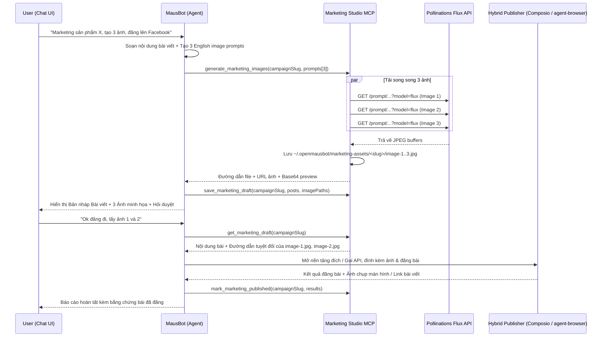

# Marketing Studio & Hybrid Publishing Pipeline Design

**Date:** 2026-10-31  
**Status:** Draft (Pending User Review)

---

## 1. Goal & Scope

Transform OpenMausBot into an end-to-end Marketing & Sales automation engine controlled directly from the chat interface. When a user requests marketing for a product or service in chat, the agent must:

1. **Copywriting**: Draft platform-optimized marketing copy (hook, value proposition, call-to-action, hashtags).
2. **Multi-Image Generation**: Automatically craft 2–4 distinct English visual prompts and generate product/lifestyle images in parallel using the free **Pollinations.ai Flux** image engine (`model=flux`), saving both physical image files on disk (for upload) and returning inline previews in chat.
3. **Preview & Confirm (Human-in-the-Loop)**: Present the drafted copy and generated images inside the chat conversation and wait for explicit user approval (or revision requests) before publishing.
4. **Hybrid Publishing**:
   - **API Route**: Use connected integrations (Composio Gmail, X/Twitter, Reddit, LinkedIn, or Postiz MCP) when an API integration is active for the target channel.
   - **Browser Route (`agent-browser`)**: Use OpenMausBot's built-in automated browser (`agent-browser` / Chrome session) to navigate to web platforms (Facebook, X, LinkedIn, Threads, forums), attach the local image files from disk, fill in the post content, and submit the post.

---

## 2. Architecture & Components

### 2.1. Marketing Studio MCP Server (`server/marketing/mcp-server.ts`)

A stdio MCP server mounted into the bot's toolset (via OpenMausBot's custom MCP server registry or built-in tool mount) exposing three focused tools:

1. **`generate_marketing_images`**
   - **Input**:
     - `campaignSlug` (`string`): Short identifier for the campaign folder (e.g. `iphone-duo-launch`).
     - `prompts` (`Array<{ prompt: string; label?: string; width?: number; height?: number }>`): 1 to 4 detailed English visual prompts.
   - **Behavior**:
     - Requests images in parallel from `https://image.pollinations.ai/prompt/<encoded>?model=flux&width=<w>&height=<h>&seed=<seed>&nologo=true&enhance=true`.
     - Validates that the HTTP response is a valid JPEG/PNG/WEBP image buffer.
     - Retries up to 2 times with a new seed on network/upstream failure (30-second timeout per attempt).
     - Writes each image to `<dataDir>/marketing-assets/<campaignSlug>/image-<index>.jpg`.
   - **Output**:
     - Returns structured JSON metadata (`filePath`, `url`, `label`, `width`, `height`) and inline MCP image content blocks (`type: "image"`, `mimeType`, `data` base64) so the chat runtime and UI can inspect and display the generated images immediately.

2. **`save_marketing_draft`**
   - **Input**:
     - `campaignSlug` (`string`)
     - `productName` (`string`)
     - `targetPlatforms` (`string[]`)
     - `posts` (`Array<{ platform: string; title?: string; body: string; hashtags?: string[]; imagePaths: string[] }>`)
   - **Behavior**:
     - Persists `<dataDir>/marketing-assets/<campaignSlug>/draft.json` with `status: "pending_approval"` and timestamps.
   - **Output**:
     - Returns the saved draft summary, local file paths for every attached image, and formatted Markdown preview blocks ready to display to the user.

3. **`get_marketing_draft` / `mark_marketing_published`**
   - **Input**:
     - `campaignSlug` (`string`)
     - `publishedResults` (optional array of `{ platform: string; status: "published" | "failed"; url?: string; note?: string }`)
   - **Behavior**:
     - Reads the saved draft during the confirmation turn so the agent has exact text and local image file paths without hallucinating paths, then updates `draft.json` once published.

### 2.2. Browser Automation Engine (`agent-browser`)

- Install and activate OpenMausBot's pinned `agent-browser` binary (`pnpm control:omb browser install`) so `browserEngine` reports `kind: "ready"`.
- Enables the bot's native browser tools (`browser_navigate`, `browser_snapshot`, `browser_click`, `browser_type`, `browser_upload`, `browser_screenshot`) to interact with web platforms using a persistent browser profile.
- When a target social platform requires login for the first time, the user logs in once via the **Computer** tab in the OpenMausBot UI; the browser profile retains cookies across turns.

### 2.3. Coordinator & Bot Instructions (`SOUL.md` / Marketing Workflow Rules)

Configure MausBot's instructions so that any marketing request follows a strict two-phase state machine:

- **Phase 1 (Draft & Preview)**:
  - Write platform-tailored copy in the user's requested language.
  - Generate 2–4 distinct Flux images via `generate_marketing_images`.
  - Save the draft via `save_marketing_draft`.
  - Display the full post copy and generated images (using Markdown image links and local paths) in the chat reply.
  - **Hard Stop**: Ask the user to approve (`"Ok đăng đi"`), select specific images, or request edits. Never publish in Phase 1.
- **Phase 2 (Confirm & Hybrid Publish)**:
  - Triggered only after the user explicitly approves in a follow-up message.
  - Load the approved draft via `get_marketing_draft`.
  - Route per platform:
    - **Email / Gmail**: Send via Composio Gmail tools.
    - **Postiz / Connected Social APIs**: Publish via Postiz or Composio MCP tools if connected.
    - **Web Platforms (Facebook, X, LinkedIn, Threads, etc.)**: Open the platform in `agent-browser`, populate the post composer, upload the selected image files from `<dataDir>/marketing-assets/<campaignSlug>/`, click the publish button, and capture a confirmation screenshot or post URL.
  - Record results via `mark_marketing_published` and report to the user.

---

## 3. Data Flow

---

## 4. Error Handling & Safety Invariants

1. **No Unapproved Publishing**: The agent must never invoke social post submission or browser submit clicks on a marketing draft until a subsequent user message confirms approval.
2. **Partial Image Generation Resilience**: `generate_marketing_images` uses `Promise.allSettled` with per-image retry (up to 2 retries, 30s timeout). If 1 of 3 prompts fails, the tool still succeeds with the remaining images and reports the failed prompt cleanly.
3. **Image Format Verification**: Downloaded buffers are checked for valid JPEG (`FF D8 FF`) or PNG (`89 50 4E 47`) magic bytes before saving to disk so broken HTML error pages from upstream are never saved as `.jpg` files.
4. **Unauthenticated Browser Session**: If `agent-browser` lands on a login wall (e.g., Facebook/X login page), the agent pauses, takes a snapshot, and instructs the user to sign in once via the **Computer** tab before replying `"Tiếp tục"`.

---

## 5. Testing & Verification Plan

1. **Unit Tests (`server/marketing/mcp-server.test.ts`)**:
   - Test parallel image generation with a local HTTP fixture verifying magic-byte validation, retry on 5xx, and file persistence under `<dataDir>/marketing-assets/<slug>/`.
   - Test draft creation, retrieval, and status transitions (`pending_approval` $\rightarrow$ `published`).
2. **Browser Engine Readiness**:
   - Install and verify `agent-browser` via `pnpm control:omb browser install` and confirm `/api/config` reports `browserEngine.kind === "ready"`.
3. **End-to-End Integration Verification**:
   - Register the Marketing Studio MCP server and verify that `tools/list` exposes `generate_marketing_images`, `save_marketing_draft`, `get_marketing_draft`, and `mark_marketing_published`.
   - Verify a complete Phase 1 preview turn and Phase 2 publish turn.
