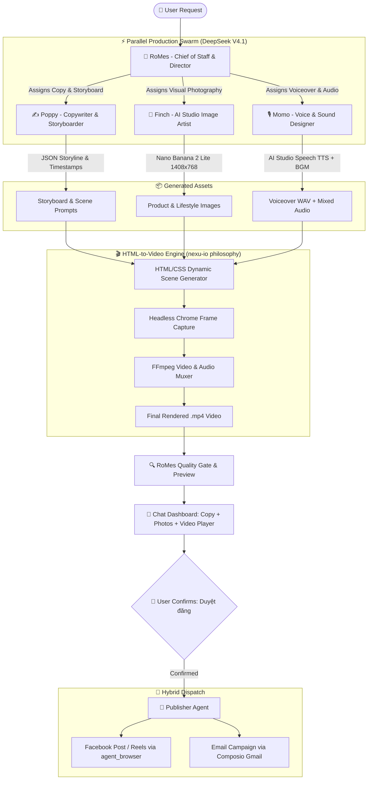

# Video Marketing Engine & Multi-Agent Swarm Architecture Design

**Date**: 2026-11-01  
**Project**: RoMes  
**Author**: Antigravity & QnShiChi  
**Status**: Approved (Brainstorming Complete)

---

## 1. Executive Summary

This specification establishes an automated, local-first **Video Marketing Engine** and a coordinated **Multi-Agent Marketing Swarm** within the RoMes platform. 

The system leverages:
1. **HTML-to-Video Core**: Programmatic video frame rendering inspired by [`nexu-io/html-video`](https://github.com/nexu-io/html-video), compiling HTML/CSS/JS scenes via local headless Google Chrome and FFmpeg into high-quality MP4 videos.
2. **Google AI Studio Speech TTS**: High-fidelity narration powered by `gemini-3.8-flash-tts` with hybrid automation (headless browser automation for 100% free operation, plus optional Gemini Speech API).
3. **Royalty-Free Audio Architecture**: Bundled commercial-safe background music (BGM) with intelligent audio ducking during spoken narration.
4. **Dual Formats**: Responsive rendering supporting both **9:16 (1080×1920)** for Reels/TikTok/Shorts and **16:9 (1920×1080)** for YouTube/Facebook/Web.
5. **Multi-Agent Marketing Swarm**: Parallel execution pipeline across specialized agents (RoMes, Poppy, Finch, Momo) all defaulting to **DeepSeek V4.1**.

---

## 2. System Architecture & Component Breakdown

---

## 3. Subsystem Specifications

### 3.1. Video Rendering Engine (`server/marketing/video-engine.ts`)
- **Philosophy**: Pure web technologies (HTML5, modern CSS animations, SVG) captured as sequential video frames.
- **Renderer**:
  - Headless Chrome (`google-chrome --headless=new --screenshot`) capturing frames at fixed timestamps matching target FPS (30fps or 60fps).
  - Target dimensions:
    - Vertical: `1080 × 1920` (9:16)
    - Horizontal: `1920 × 1080` (16:9)
- **Muxer & Encoder**:
  - `ffmpeg` binary on Linux host:
    - Video codec: `libx264`, `pix_fmt: yuv420p`, profile: `high`
    - Audio codec: `aac`, bitrate: `192k`
    - Frame assembly: `ffmpeg -framerate {fps} -i frame_%05d.png -i mixed_audio.mp3 -c:v libx264 -c:a aac -shortest {output}.mp4`

### 3.2. Google AI Studio Speech Engine (`server/marketing/speech-engine.ts`)
- **Model**: `gemini-3.8-flash-tts` / Gemini TTS
- **Hybrid Modes**:
  1. *Headless Browser Automation (Default / Free)*:
     - Automated background browser accesses `https://aistudio.google.com/generate-speech?model=gemini-3.8-flash-tts`.
     - Submits narration script, selects voice profile, captures download stream, and writes audio to `marketing-assets/voice/{campaignSlug}_speech.wav`.
  2. *API SDK Dispatch (Optional)*:
     - Direct RPC / REST call if `GEMINI_API_KEY` is present.
- **Audio Ducking**:
  - Automatically measures speech timestamps and applies FFmpeg volume ducking to BGM (`volume=0.15` during voiceover, restoring to `volume=0.85` in transitions).

### 3.3. Royalty-Free BGM Catalog
- Bundled audio loops stored in `server/marketing/assets/bgm/`:
  - `tech-modern.mp3`
  - `upbeat-energy.mp3`
  - `chill-lofi.mp3`
  - `luxury-cinematic.mp3`
- User overrides supported via `~/.openmausbot/workspaces/default/marketing-assets/bgm/`.

### 3.4. Marketing Scene Templates
Four standardized scene layouts:
1. **Hook Scene (0–3s)**: Kinetic headline typography, gradient backdrop, animated badge.
2. **Product Showcase Scene (3–10s)**: High-resolution Nano Banana 2 Lite 1408×768 product shot rendered with Ken Burns pan & slow zoom.
3. **Core Features Scene (10–20s)**: Animated bullet points, feature cards, moving Chibi mascot badges.
4. **Call-To-Action Scene (20–30s)**: Animated RoMes branding, website URL, CTA button banner.
- **Kinetic Subtitles**: CSS-styled subtitle overlay (high contrast, stroke border) synced to speech pacing.

---

## 4. Multi-Agent Swarm Orchestration

All agents default to **DeepSeek V4.1** (`openrouter: deepseek/deepseek-v4.1-flash-1017`).

| Agent | Role | Tools & Capabilities |
|---|---|---|
| **RoMes** | Chief of Staff & Creative Director | Campaign orchestration, review gate, user interaction |
| **Poppy** | Senior Copywriter & Storyboarder | AIDA/PAS copy synthesis, JSON storyboard generation |
| **Finch** | Visual Art & AI Photographer | Nano Banana 2 Lite image generation via Google AI Studio |
| **Momo** | Voiceover & Sound Designer | Google AI Studio Speech synthesis, BGM selection, audio ducking |
| **Publisher** | Multi-Channel Dispatcher | `agent_browser` Facebook posting, Composio Gmail dispatch |

---

## 5. Verification & Test Strategy
- Unit tests for `server/marketing/video-engine.ts` verifying scene HTML generation and FFmpeg parameter formatting.
- Unit tests for `server/marketing/speech-engine.ts` verifying script chunking and audio ducking filter graphs.
- Integration tests simulating end-to-end storyboard compilation into MP4.
- Verification across Vitest, Oxlint, and TypeScript typecheck.
