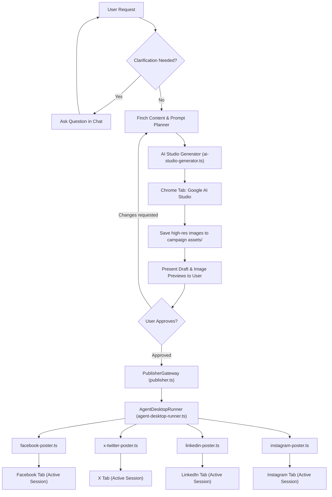

# Agent-Desktop Social Automation & AI Studio Image Pipeline Design

## 1. Overview & Objective

This design defines the architecture for automated social media publishing and AI image generation in OpenMausBot (RoMes & Finch) using **`vercel-labs/agent-desktop`** and active browser session integration.

### Core Goals
1. **High Performance & User Experience First**: Actions complete in seconds (not minutes). Text and assets are injected via clipboard/direct input rather than slow keystroke-by-keystroke synthesis.
2. **Zero Coordinate Guessing / No Button Fumbling ("Không mò nút")**: Replace flaky vision-based computer-use coordinate estimation with OS Accessibility Trees (`agent-desktop` semantic `@ref` targeting).
3. **No Hardcoding ("Tuyệt đối không hardcoded")**: Dynamic matching by semantic roles, localized accessible text patterns (regex), dynamic tab lookups, configurable timeouts, and parameter-driven asset lists.
4. **Interactive Clarification ("Không rõ thì hỏi người dùng")**: The agent must never guess user intent, missing parameters, or privacy choices. Clarification occurs before execution; drafts must be approved before publishing.
5. **Purge Low-Quality Fallbacks**: Completely remove `pollinations.ai` and geometric gradient oval generation (`generateFallbackGradientImage`). AI images are produced via Google AI Studio with commercial branding prompts.

---

## 2. System Architecture



---

## 3. Component Specifications

### 3.1. `AgentDesktopRunner` (`server/marketing/social-scripts/agent-desktop-runner.ts`)
A robust wrapper around the `agent-desktop` CLI providing:
- **`findWindow(appRegex: RegExp)`**: Dynamically discovers running application windows without hardcoding PIDs.
- **`findTab(windowRef: string, titleRegex: RegExp)`**: Finds accessible tab elements matching target regex (e.g. `/facebook/i`, `/google ai studio/i`).
- **`findActionable(rootRef: string, criteria: ElementQuery)`**: Queries accessibility nodes by `role` (`button`, `textfield`, `tab`, etc.) and `name` matching regex.
- **`fastPaste(targetRef: string, text: string)`**: Sets OS clipboard via `agent-desktop clipboard-set` and fires `Ctrl+V` (or `Cmd+V` on macOS). Executes in <100ms.
- **`attachFiles(targetRef: string, filePaths: string[])`**: Injects file paths into standard file upload inputs or pastes images via clipboard.
- **`safeRetry<T>(action: () => Promise<T>, maxRetries: number)`**: Handles `STALE_REF` and `AMBIGUOUS_TARGET` errors by re-snapshotting the element tree.

### 3.2. Social Poster Modules (`server/marketing/social-scripts/`)

All poster modules implement the unified `SocialPoster` interface:

```typescript
export interface SocialPostPayload {
  text: string;
  images: string[];
  campaignId: string;
  options?: Record<string, unknown>;
}

export interface SocialPostResult {
  success: boolean;
  platform: "facebook" | "x" | "linkedin" | "instagram";
  postUrl?: string;
  durationMs: number;
  error?: string;
}

export interface SocialPoster {
  readonly platform: string;
  isAvailable(): Promise<boolean>;
  publish(payload: SocialPostPayload): Promise<SocialPostResult>;
}
```

#### A. `facebook-poster.ts`
- **Tab Lookup**: Dynamically identifies tab matching `/facebook\.com/i` in running browser.
- **Composer Detection**: Finds button matching `/(bạn đang nghĩ gì|what's on your mind|tạo bài viết|create post)/i`.
- **Text Insertion**: `fastPaste` to inject content, preserving Vietnamese UTF-8 characters and formatting.
- **Multi-Image Attachment**: Injects array of image paths into file attachment input or pastes image files into composer.
- **Submit**: Finds submit button matching `/(đăng|post)/i`. Waits for dialog disappearance (`--wait-for-gone`) to verify submission.

#### B. `x-twitter-poster.ts`
- **Composer**: Targets `/twitter\.com|x\.com/i`, finds textbox matching `/(what is happening|có chuyện gì đang xảy ra|post text)/i`.
- **Media**: Attaches up to 4 images to media file input.
- **Submit**: Clicks button matching `/^(post|đăng)$/i`. Verifies post confirmation.

#### C. `linkedin-poster.ts`
- **Composer**: Targets `/linkedin\.com/i`, finds `Start a post` button.
- **Media**: Attaches media via "Add media" action $\to$ completes media step $\to$ pastes text in post body.
- **Submit**: Clicks "Post" button and verifies toast notification.

#### D. `instagram-poster.ts`
- **Composer**: Targets `/instagram\.com/i` (or Threads), clicks "New post".
- **Media Carousel**: Selects multiple images in sequence, navigates to caption step.
- **Submit**: Pastes caption and clicks "Share".

### 3.3. Google AI Studio Image Generator (`ai-studio-generator.ts`)
- **Connection**: Detects active tab `/aistudio\.google\.com/i`.
- **Prompt Formulation**: Injects marketing prompt formulated by Finch (including lighting, composition, commercial branding, negative constraints).
- **Execution**: Sends execution shortcut (`Ctrl+Enter`) or clicks Run button.
- **Extraction**: Awaits completed generation element, extracts source image data directly, and saves clean files to `assets/image-1.jpg`, `assets/image-2.jpg`, etc.
- **Fallback Elimination**: `pollinations.ai` URLs and `generateFallbackGradientImage` are completely removed. If generation fails or session is invalid, returns descriptive error for immediate user notification.

---

## 4. No Hardcoding ("Tuyệt đối không hardcoded")

To satisfy the strict no-hardcoding requirement:
1. **Dynamic Tab Matching**: Tab identifiers are resolved dynamically at runtime using regular expressions against the browser window's accessibility subtree.
2. **Dynamic UI Selectors**: Elements are queried by accessibility role (`button`, `textbox`, `combobox`) and multilingual regex patterns (`/đăng|post/i`), accommodating language settings (Vietnamese, English) and UI shifts.
3. **Configurable Environment & Timeouts**: Timeouts, retry counts, and target platforms are configured via options/environment variables, with sensible defaults (5-8s max wait per step).
4. **Dynamic Image Paths**: Accepts arbitrary array of file paths (`images: string[]`) rather than fixed indices or static filenames.
5. **No Static Ref IDs**: `@ref` identifiers generated by `agent-desktop snapshot` are ephemeral; scripts always parse fresh snapshot trees dynamically.

---

## 5. Interactive Clarification Protocol ("Không rõ thì hỏi người dùng")

The agent follows an interactive clarification protocol across two stages:

### Stage 1: Pre-Execution Requirements Clarification
If the user's initial request lacks critical details:
- **Missing Image Count**: Bot asks *"Bạn muốn tạo bao nhiêu ảnh cho bài viết này (ví dụ: 1, 3 hay 4 ảnh)?"*
- **Ambiguous Platform**: Bot asks *"Bạn muốn đăng lên nền tảng nào (Facebook, X, LinkedIn, hay Instagram)?"*
- **Brand / Audience Context**: Bot asks clarifying questions to tailor the visual style and marketing copy.

### Stage 2: Draft Review & Approval Gate
- Content and generated images are displayed in chat for user inspection.
- The publishing script is **never** executed without explicit user confirmation (e.g. *"OK, đăng đi"*).

### Stage 3: Runtime Ambiguity Handling
- If a platform presents an ambiguous UI state (e.g., Facebook asking for post privacy settings "Public" vs "Friends", or page selection), the script halts, reports the options, and prompts the user for instructions.

---

## 6. Error Handling & Performance Invariants

1. **Total Execution Target**: Under 5 seconds for publishing an approved post with multiple images.
2. **Step Timeout**: 5,000ms maximum per individual action.
3. **Stale Ref Recovery**: 1 automatic retry on `STALE_REF` with a 300ms snapshot refresh budget.
4. **Data Safety**: Content is saved in the campaign store and placed in the OS clipboard before posting begins, ensuring zero data loss even in case of browser crashes.

---

## 7. Verification & Testing Plan

1. **Unit Tests (`server/marketing/social-scripts/*.test.ts`)**:
   - Mock CLI execution of `agent-desktop`.
   - Verify parsing of accessibility trees and correct extraction of `@ref` IDs.
   - Verify regex matching for multilingual elements (Vietnamese & English).
2. **Purge Verification**:
   - Grep entire repository for `pollinations.ai` and `generateFallbackGradientImage` to confirm complete removal.
3. **Regression Tests**:
   - Run existing suite (`pnpm test:server` or vitest for `server/marketing`) to ensure all 82+ tests continue passing.
4. **E2E Browser Validation**:
   - Test against running Chrome window using non-destructive fixture commands (`findTab`, `snapshot`).
