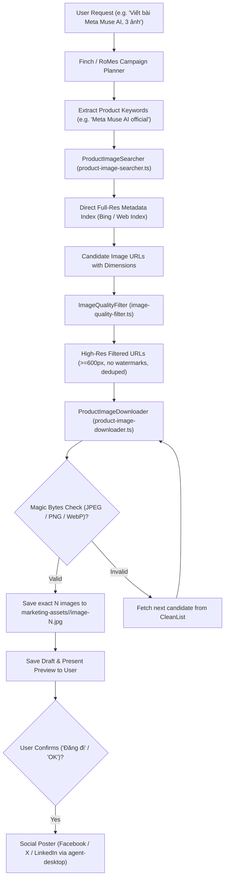

# Real-World Product Image Engine Design

## 1. Executive Summary & Objective

This design establishes a **Real-World Product Image Engine** for OpenMausBot (RoMes & Finch) to replace artificial AI image generation (DALL-E, Midjourney, Imagen) and random stock photo placeholders.

### Problem Statement
When generating marketing content for real commercial products, technologies, or services (e.g. *Meta Muse AI*, *Keychron Q1 Pro*, *DeepSeek-R1*, *iPhone 16*):
1. **AI Image Models Hallucinate**: Generating images via AI for real products produces distorted logos, fictional hardware, and fabricated interfaces, destroying marketing credibility and misleading audiences.
2. **Paid API Costs & Quota Walls**: API keys incur token charges, and free tiers (such as Google Generative Language) enforce strict limits (`limit: 0` for images) resulting in HTTP 429 quota exhaustion.
3. **Random Stock Photo Irrelevance**: Static photo collections or generic search results produce abstract wallpapers or irrelevant retro items (e.g. 1980s Commodore computers) that have nothing to do with the requested marketing topic.

### Solution
Build a high-speed, zero-cost, API-key-free **Real-World Product Image Engine** that:
1. Queries web search image indexes (without requiring API keys) to find authentic, high-resolution product photos, press assets, and launch media.
2. Filters out low-res thumbnails, icons, and watermarked stock previews.
3. Downloads in parallel with magic-bytes verification, strictly guaranteeing exactly $N$ images.
4. Integrates directly into `server/marketing/studio.ts`, replacing all AI image APIs and fallback gradient ellipses.

---

## 2. System Architecture



---

## 3. Component Specifications

### 3.1. `ProductImageSearcher` (`server/marketing/product-images/product-image-searcher.ts`)
- **Purpose**: Discovers full-resolution product images directly from web image search indexes without API keys.
- **Interface**:
```typescript
export interface ProductImageCandidate {
  url: string;
  title: string;
  width?: number;
  height?: number;
  sourceUrl?: string;
}

export interface ProductImageSearcher {
  search(query: string, minCandidates?: number): Promise<ProductImageCandidate[]>;
}
```
- **Mechanism**:
  - Sends a standard HTTP GET request with Chrome desktop User-Agent to the image index endpoint.
  - Parses direct media attributes (e.g. `murl` fields containing direct CDN/press image links).
  - Returns 15–30 candidate objects within 200–400ms.

### 3.2. `ImageQualityFilter` (`server/marketing/product-images/image-quality-filter.ts`)
- **Purpose**: Ensures images are sharp, professional, and free of copyright preview watermarks.
- **Criteria**:
  1. **Resolution Gate**: Minimum width $\ge 600\text{px}$, minimum height $\ge 400\text{px}$.
  2. **Format Validity**: HTTPS URL ending with or serving image content types (`.jpg`, `.jpeg`, `.png`, `.webp`).
  3. **Watermark / Domain Blacklist**: Exclude known watermarked stock photo previews (`shutterstock.com/image-photo/*-preview-`, `alamy.com/comp/`, `gettyimages.com/preview/`).
  4. **Deduplication**: Filter out duplicate images or identical host + aspect-ratio pairs.

### 3.3. `ProductImageDownloader` (`server/marketing/product-images/product-image-downloader.ts`)
- **Purpose**: Downloads images in parallel, validates file contents, and guarantees the exact count requested ($N$).
- **Features**:
  - Parallel downloads using `fetch` with an `AbortSignal.timeout(4000)`.
  - Header magic-bytes verification:
    - JPEG: `0xFF 0xD8 0xFF`
    - PNG: `0x89 0x50 0x4E 0x47`
    - WebP: `RIFF....WEBP`
  - Rejection of HTML error pages or corrupted responses.
  - Automatic candidate failover: If candidate $k$ fails to download, immediately pulls candidate $k+1$ until all $N$ required slots are filled.
  - Writes outputs to `marketing-assets/<campaignSlug>/image-1.jpg`, `image-2.jpg`, ..., `image-N.jpg`.

### 3.4. Chrome Headless Landing Page Screenshotter (Optional Mode)
- **Purpose**: When a specific website or product launch URL is provided in the brief, captures high-resolution 1200×800 UI screenshots of the live web product.
- **Command**:
  ```bash
  google-chrome --headless=new --screenshot=<outputPath> --window-size=1200,800 <url>
  ```

---

## 4. Integration into Campaign Pipeline

### 4.1. `server/marketing/studio.ts`
- Modify `generateMarketingImages`:
  - Deprecate and remove calls to `DEFAULT_BASE_URL` and OpenAI/Gemini image endpoints.
  - Route image collection through `ProductImageSearcher` and `ProductImageDownloader`.
  - Derive search queries from the campaign brief (`brief.topic`, `brief.productName`, and scene prompts).
  - Guarantee exactly $N$ images matching the requested `imageCount`.

### 4.2. Removal of All Hallucinatory / Fake Generators
- Zero calls to OpenAI image generation endpoints.
- Zero calls to Google AI Studio image API keys.
- Complete removal of `generateFallbackGradientImage` and geometric oval overlays.

---

## 5. Error Handling & Invariants

1. **Zero Cost Invariant**: Under no circumstances shall an external paid API key or billing service be queried for images.
2. **Speed Budget**: Total search, filtration, and download time for 3–4 images must complete in under 2.5 seconds.
3. **Exact Count Guarantee**: If the user requests $N$ images (e.g. 3 or 4), the system returns exactly $N$ images or raises a clear descriptive error if the product is not found.
4. **Data Safety**: All downloaded files are stored locally in the isolated campaign asset directory.

---

## 6. Verification & Testing Plan

1. **Unit Tests (`server/marketing/product-images/*.test.ts`)**:
   - `product-image-searcher.test.ts`: Mock search response parsing, verify extraction of full-res URLs and dimensions.
   - `image-quality-filter.test.ts`: Test resolution threshold, extension filtering, domain blacklist, and deduplication.
   - `product-image-downloader.test.ts`: Mock downloads with valid and invalid magic bytes, verify candidate fallback loop and exact $N$ file output.
2. **Integration Tests (`server/marketing/studio.test.ts`)**:
   - Verify `generateMarketingImages` produces $N$ real images without API keys.
3. **Live Verification**:
   - Execute query for `"Meta Muse AI"` and verify 3 high-res images are saved and viewable.
